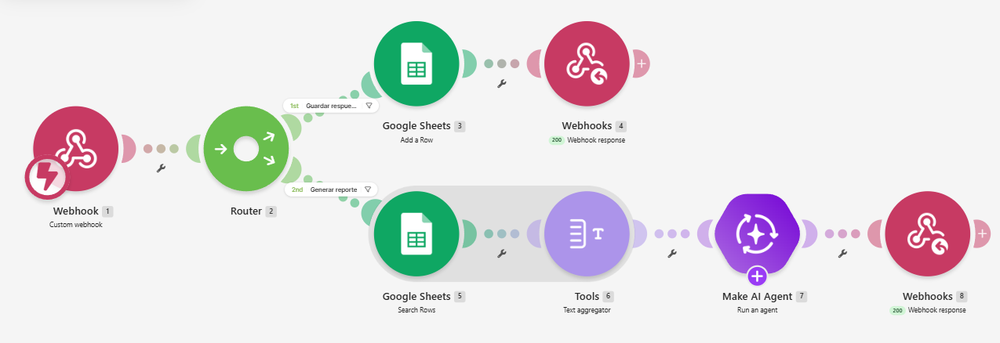
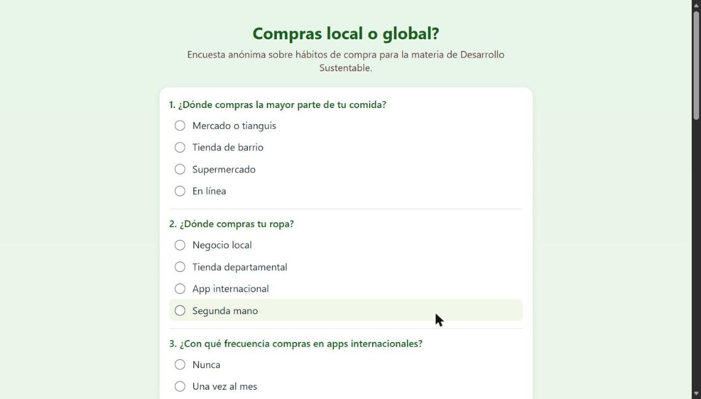
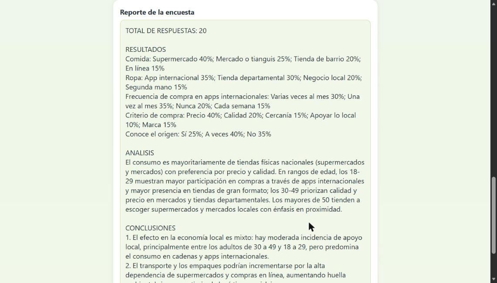
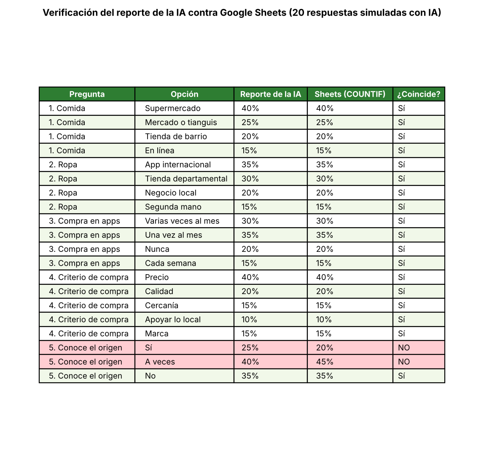

# Práctica 4.2 — Encuesta "¿Compras local o global?"

- **Alumno:** Cesar Jesus Gamez Mendoza
- **Carrera:** Ingeniería en Sistemas Computacionales — TecNM Campus Mazatlán
- **Materia:** Desarrollo Sustentable (ACD-0908) — Unidad 4, tema 4.2 Economía global vs. economía local y PIB
- **Profesor:** Mtro. Miguel Ángel Barrón Hernández
- **Modalidad:** individual

> **AVISO IMPORTANTE — DATOS SIMULADOS CON IA.** No pude aplicar la encuesta a 20 personas reales, así que las **20 respuestas fueron simuladas con ayuda de IA** y cargadas a la hoja de cálculo a través del mismo formulario web (con el flujo real de Make). Todo lo demás (página, escenario de Make, Google Sheets, reporte del agente de IA y verificación con fórmulas) es real y funciona. Por eso los porcentajes **no representan a la comunidad de Mazatlán**; sirven para demostrar y probar el método. Mis respuestas al informe analizan estos datos simulados y lo indico cada vez que es relevante.

## Descripción
Hice una encuesta anónima de 6 preguntas sobre hábitos de compra (dónde compro comida y ropa, cuánto compro en apps internacionales, qué pesa más al comprar, si conozco el origen de lo que compro y mi rango de edad). La página la publiqué con GitHub Pages y se conecta con un escenario de Make que guarda cada respuesta en Google Sheets y que, al presionar **Generar reporte**, manda todas las respuestas a un agente de IA (Make AI Agent) que devuelve resultados, análisis y conclusiones.

## Enlaces
- **Página de la encuesta:** https://cesargm-max.github.io/Encuesta-local-o-global/Codigo/
- **Video de la prueba en vivo:** [Video/enlace.txt](Video/enlace.txt)
- **Resultados (PDF):** [Resultados/Resultados.pdf](Resultados/Resultados.pdf)

## Estructura del repositorio
- [`Codigo/index.html`](Codigo/index.html): página de la encuesta (HTML + JavaScript).
- [`Codigo/blueprint.json`](Codigo/blueprint.json): blueprint del escenario de Make, ya con los dos filtros de las rutas.
- [`Codigo/GUIA_MAKE.md`](Codigo/GUIA_MAKE.md): explicación módulo por módulo.
- [`Codigo/respuestas_simuladas.csv`](Codigo/respuestas_simuladas.csv): las 20 respuestas simuladas con IA.
- [`Imagenes/`](Imagenes/): capturas del escenario, la página, el reporte y la verificación.
- [`Resultados/Resultados.pdf`](Resultados/Resultados.pdf): resumen de lo aprendido.
- [`Video/enlace.txt`](Video/enlace.txt): enlace al video en YouTube.

## Cómo funciona (escenario de Make)
Página web → **Webhook** → **Router** con dos rutas, cada una con su **filtro** (el campo `accion` que manda la página):

1. **Filtro "Guardar respuesta"** (`accion` *Equal to* `respuesta`) → Google Sheets *Add a Row* (Fecha, Comida, Ropa, Apps, Criterio, Origen, Edad) → *Webhook Response* "Respuesta registrada. Gracias por participar."
2. **Filtro "Generar reporte"** (`accion` *Equal to* `reporte`) → Google Sheets *Search Rows* (hasta 200 filas) → *Text aggregator* (una línea por respuesta, columnas separadas con `|`) → *Make AI Agent* (con un prompt que explica cada columna y el formato del reporte) → *Webhook Response* con el texto del reporte.

Los dos *Webhook Response* regresan Status 200 y los headers `Content-Type: text/plain; charset=utf-8` y `Access-Control-Allow-Origin: *`, que es lo que permite que la página (en github.io) lea la respuesta de Make.




## Resultados de la encuesta (20 respuestas simuladas con IA)
| N | Comida | Ropa | Apps | Criterio | Origen | Edad |
|---|---|---|---|---|---|---|
| 1 | Supermercado | App internacional | Varias veces al mes | Precio | No | 18 a 29 |
| 2 | Mercado o tianguis | Negocio local | Una vez al mes | Calidad | Sí | 30 a 49 |
| 3 | Supermercado | Tienda departamental | Una vez al mes | Precio | A veces | 18 a 29 |
| 4 | Tienda de barrio | Segunda mano | Nunca | Cercanía | Sí | 50 o más |
| 5 | En línea | App internacional | Cada semana | Marca | No | 18 a 29 |
| 6 | Mercado o tianguis | Tienda departamental | Una vez al mes | Calidad | A veces | 30 a 49 |
| 7 | Supermercado | App internacional | Varias veces al mes | Precio | No | 18 a 29 |
| 8 | Tienda de barrio | Negocio local | Nunca | Apoyar lo local | Sí | 50 o más |
| 9 | Supermercado | Tienda departamental | Una vez al mes | Precio | A veces | 30 a 49 |
| 10 | Mercado o tianguis | Segunda mano | Varias veces al mes | Precio | A veces | 18 a 29 |
| 11 | En línea | App internacional | Cada semana | Marca | No | 18 a 29 |
| 12 | Supermercado | Tienda departamental | Nunca | Calidad | A veces | 30 a 49 |
| 13 | Mercado o tianguis | Negocio local | Una vez al mes | Apoyar lo local | Sí | 18 a 29 |
| 14 | Tienda de barrio | App internacional | Varias veces al mes | Precio | No | 18 a 29 |
| 15 | Supermercado | Tienda departamental | Una vez al mes | Cercanía | A veces | Menos de 18 |
| 16 | En línea | App internacional | Cada semana | Precio | No | 18 a 29 |
| 17 | Mercado o tianguis | Tienda departamental | Una vez al mes | Calidad | A veces | 30 a 49 |
| 18 | Supermercado | App internacional | Varias veces al mes | Marca | No | 18 a 29 |
| 19 | Tienda de barrio | Segunda mano | Nunca | Cercanía | A veces | 18 a 29 |
| 20 | Supermercado | Negocio local | Varias veces al mes | Precio | A veces | 30 a 49 |

### Reporte generado por el agente de IA (tal cual)
```
TOTAL DE RESPUESTAS: 20

RESULTADOS
Comida: Supermercado 40%; Mercado o tianguis 25%; Tienda de barrio 20%; En línea 15%
Ropa: App internacional 35%; Tienda departamental 30%; Negocio local 20%; Segunda mano 15%
Frecuencia de compra en apps internacionales: Varias veces al mes 30%; Una vez al mes 35%; Nunca 20%; Cada semana 15%
Criterio de compra: Precio 40%; Calidad 20%; Cercanía 15%; Apoyar lo local 10%; Marca 15%
Conoce el origen: Sí 25%; A veces 40%; No 35%

ANALISIS
El consumo es mayoritariamente de tiendas físicas nacionales (supermercados y mercados) con preferencia por precio y calidad. En rangos de edad, los 18-29 muestran mayor participación en compras a través de apps internacionales y mayor presencia en tiendas de gran formato; los 30-49 priorizan calidad y precio en mercados y tiendas departamentales. Los mayores de 50 tienden a escoger supermercados y mercados locales con énfasis en proximidad.

CONCLUSIONES
1. El efecto en la economía local es mixto: hay moderada incidencia de apoyo local, principalmente entre los adultos de 30 a 49 y 18 a 29, pero predomina el consumo en cadenas y apps internacionales.
2. El transporte y los empaques podrían incrementarse por la alta dependencia de supermercados y compras en línea, aumentando huella ambiental si no se optimiza la logística y reciclaje.
3. Acción concreta: fomentar ferias y promociones de productores locales en mercados y tiendas de barrio, acompañadas de campañas de transparencia de origen para aumentar el porcentaje de conocimiento del origen.
```


### Verificación con fórmulas en Google Sheets
La hoja se llama `Respuestas` (A = Fecha, B = Comida, C = Ropa, D = Apps, E = Criterio, F = Origen, G = Edad). Verifiqué **las 5 preguntas** con `COUNTIF`, por ejemplo:

```
=COUNTIF(Respuestas!B:B; "Mercado o tianguis") / COUNTA(Respuestas!B2:B)    -> 25%
=COUNTIF(Respuestas!B:B; "Supermercado") / COUNTA(Respuestas!B2:B)         -> 40%
=COUNTIF(Respuestas!F:F; "Sí") / COUNTA(Respuestas!F2:F)                   -> 20%
=COUNTIF(Respuestas!F:F; "A veces") / COUNTA(Respuestas!F2:F)              -> 45%
```

Como las respuestas están en [`respuestas_simuladas.csv`](Codigo/respuestas_simuladas.csv), también recalculé los porcentajes con un script para confirmar los números de la fórmula. Resultado de la comparación:



**La IA acertó las preguntas 1 a 4 completas, pero se equivocó en la pregunta 5 (origen):** dijo Sí 25% / A veces 40% / No 35%, y el conteo real es **Sí 20% (4) / A veces 45% (9) / No 35% (7)**. Además, en su análisis dijo que los mayores de 50 "tienden a escoger supermercados y mercados locales", cuando en los datos las dos personas de 50 o más compran en **tienda de barrio**. Tuve que corregir el escenario varias veces: en la primera prueba el reporte salió con 0 respuestas porque Make entrega las columnas con números (`5.1`, `5.2`…, uno por columna) y no con el nombre del encabezado, y después la IA mezcló columnas hasta que le expliqué en el prompt qué significa cada una.

## Preguntas del informe

**1. ¿El consumo de su comunidad es más local o más global? ¿En qué productos se nota más?**
Con los datos simulados, el consumo es más bien mixto con inclinación a lo global en ropa y a lo local en comida. En comida, 9 de 20 personas (45%) compran en mercado o tianguis y tienda de barrio, que son canales locales, contra 8 (40%) en supermercado y 3 (15%) en línea. En ropa lo global se nota más: 7 de 20 (35%) la compran en apps internacionales y 6 (30%) en tiendas departamentales de cadena, mientras que solo 4 (20%) la compran en negocios locales y 3 (15%) de segunda mano. Además, 16 de 20 (80%) compran en apps internacionales al menos una vez al mes. Por edad, las 7 personas que compran ropa en apps internacionales tienen entre 18 y 29 años, y las 2 de 50 o más no compran nunca en apps. Aunque son datos simulados, muestran que el producto donde más pesa lo global es la ropa y que los jóvenes son quienes más lo empujan.

**2. ¿Qué efecto tiene en el PIB y en el empleo de Mazatlán que las personas compren en apps internacionales?**
El PIB local mide lo que se produce dentro de Mazatlán, y cuando una compra se hace en una app internacional gran parte del dinero sale de la ciudad: lo recibe una empresa de otro país y no paga sueldos ni renta ni proveedores locales. En cambio, cuando compro en un negocio local, ese dinero paga empleados de la ciudad, y esos empleados lo gastan otra vez aquí; ese efecto multiplicador se pierde con la compra en línea internacional. Con los datos simulados, 35% compra su ropa en apps internacionales y 15% su comida en línea, lo que significa que una parte importante del gasto de esas personas ya no genera ventas para el comercio de la colonia. Con menos ventas, los negocios pequeños contratan menos o cierran, lo que afecta el empleo, sobre todo en comercio y servicios. No puedo medir con una encuesta de 20 respuestas simuladas cuánto cambia el PIB real de Mazatlán, pero sí ilustra la dirección del efecto: menos consumo local significa menos ingresos y empleos locales, aunque las apps también ofrecen precios bajos que benefician al consumidor (40% decide por precio).

**3. ¿Qué impacto ambiental tiene el transporte y el empaque de lo que se compra en línea desde otro país?**
Un producto que viene de otro país recorre miles de kilómetros en barco, avión y camión, y eso consume combustible y emite CO₂, mucho más que algo producido en la región. Las compras en línea además llegan en paquetes individuales, con caja de cartón, plástico, bolsas y relleno, así que se genera mucho más residuo de empaque que cuando compro varias cosas juntas en un mercado. Muchas veces el envío es en avión para que llegue rápido, que es de los medios con más emisiones por kilo transportado. A esto se suma la ropa de moda rápida, que se compra barata, se usa poco y se desecha, y las devoluciones, que duplican el viaje. En los datos simulados, 16 de 20 personas compran en apps internacionales al menos una vez al mes, así que el efecto se repite muchas veces; en cambio, comprar en el mercado o la tienda de barrio reduce el transporte y permite llevar bolsa propia.

**4. ¿Coincidieron los porcentajes de la IA con los de Sheets? ¿Qué aprendí sobre verificar a la IA?**
Coincidieron en 4 de las 5 preguntas (comida, ropa, apps y criterio de compra), con todos los porcentajes iguales a los de la fórmula `COUNTIF`. En la pregunta 5 (conoce el origen) no coincidieron: la IA reportó Sí 25% y A veces 40%, pero en la hoja son Sí 20% y A veces 45%; solo "No 35%" quedó bien. También encontré un error en el análisis escrito: dijo que los mayores de 50 escogen supermercados, y los datos muestran que ambos compran en tienda de barrio. Aprendí que una IA puede dar un reporte que se ve bien y seguro, pero contar mal, y que no se nota si no se compara con una fórmula. En mi primera prueba incluso devolvió 0 respuestas por un error mío de configuración, y luego mezcló columnas hasta que le expliqué el significado de cada una en el prompt. Por eso verificar con `COUNTIF` no es opcional: la IA sirve para redactar y analizar, pero los números los tengo que comprobar yo.

**5. ¿Qué acción concreta propondría para impulsar el consumo local en su colonia?**
Propondría una feria semanal de productores y comercios de la colonia, por ejemplo los sábados en una cancha o parque, con puestos de verdura, mariscos, pan, ropa y artesanías hechos en Mazatlán o en Sinaloa. Los puestos tendrían un letrero visible con el origen del producto (quién lo hizo y dónde), porque en los datos simulados solo 20% dice que sabe de dónde viene lo que compra y el otro 80% lo sabe solo a veces o no lo sabe. Se promovería en un grupo de WhatsApp y redes de la colonia con un descuento o sello de lealtad para quien compre varias veces, ya que el precio es el criterio principal (40%) y hay que competir contra las apps. También se podría invitar a los jóvenes de 18 a 29 años, que son quienes más compran en apps, con una sección de ropa de segunda mano y diseñadores locales. Con eso se apoya al comercio local y se reduce el transporte y el empaque de lo que consumimos.

## Conclusión
Esta práctica me mostró cómo conectar una página web con Make, Google Sheets y una IA para recolectar y analizar datos de una encuesta de forma automática, y también que los resultados de la IA hay que verificarlos con fórmulas porque puede equivocarse al contar. Las 20 respuestas fueron simuladas con IA, así que las conclusiones sobre Mazatlán no son datos reales; lo que sí es real es el sistema funcionando, que puede aplicarse tal cual con respuestas de personas.
